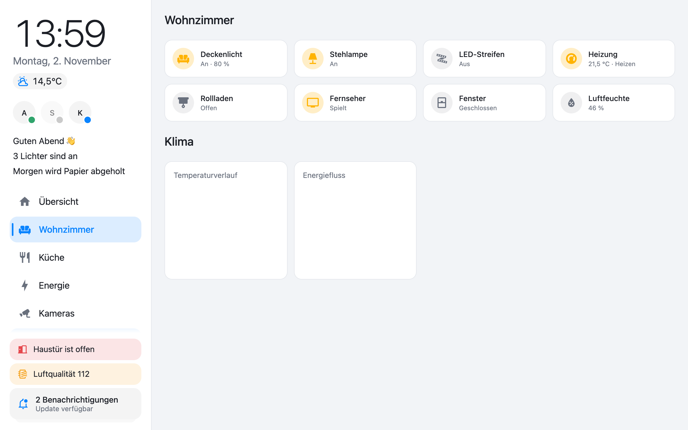
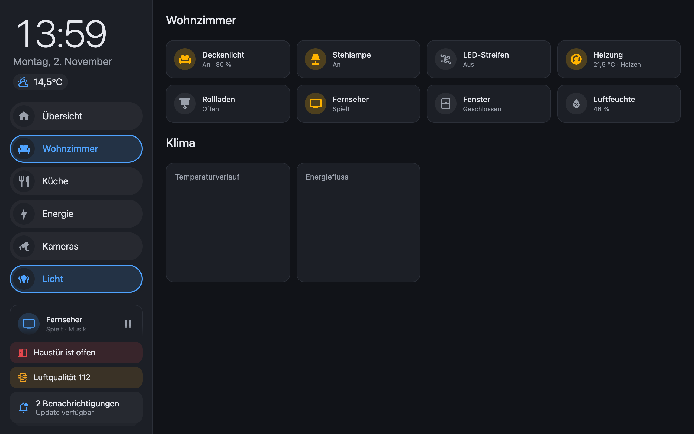
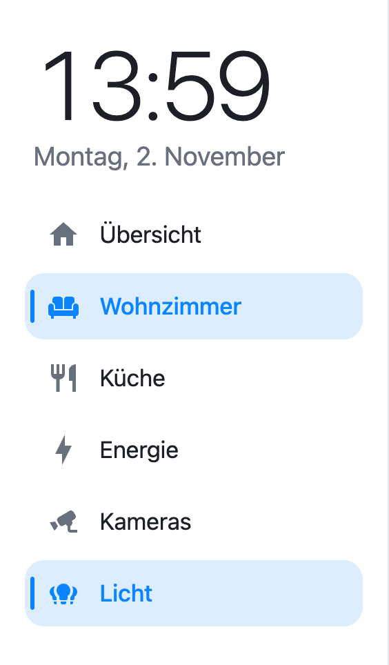
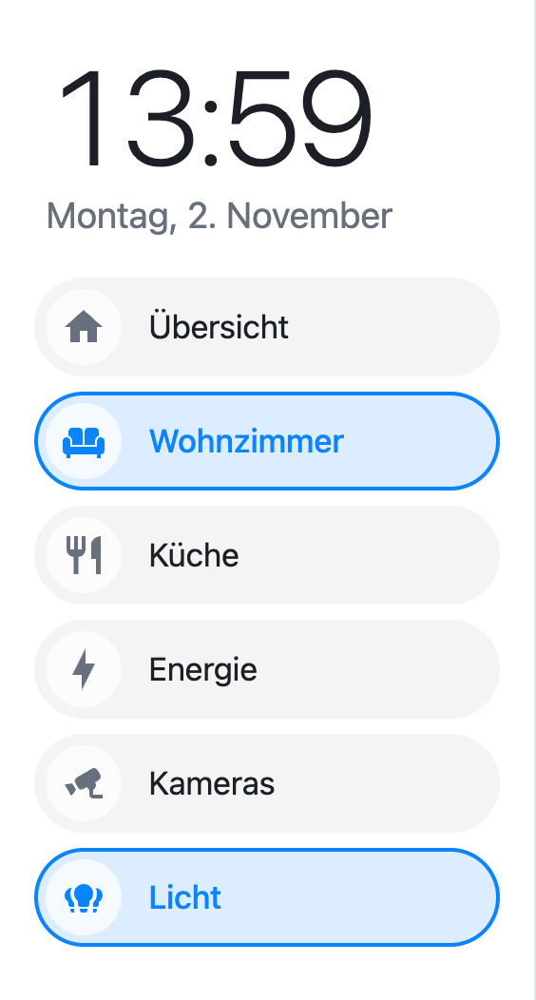
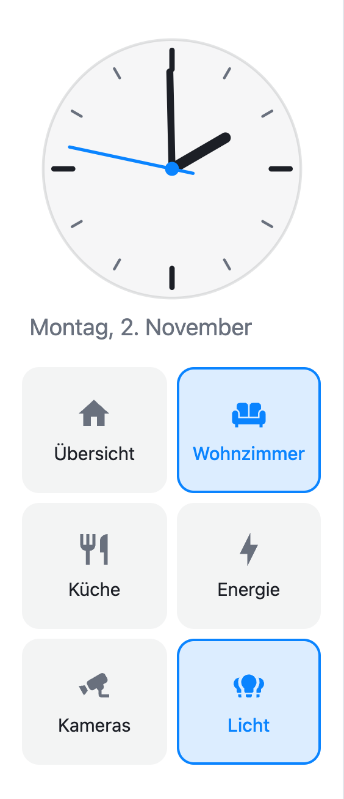
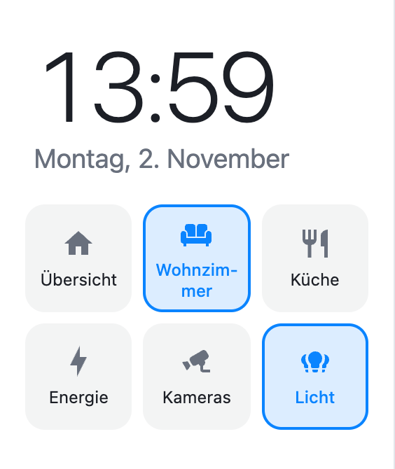
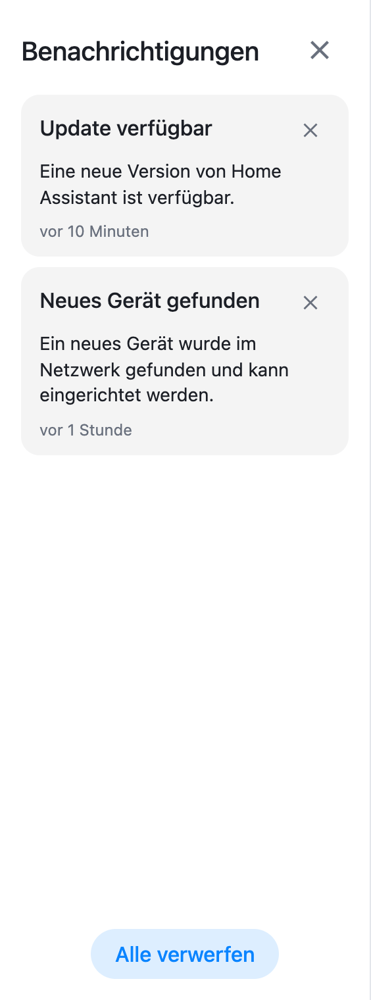
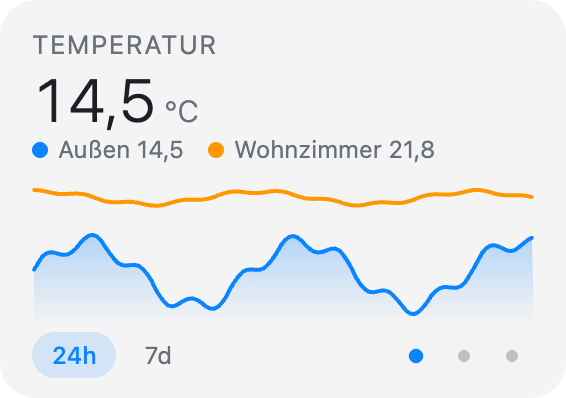
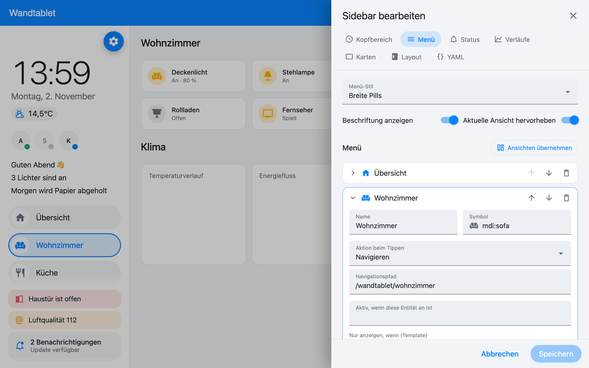
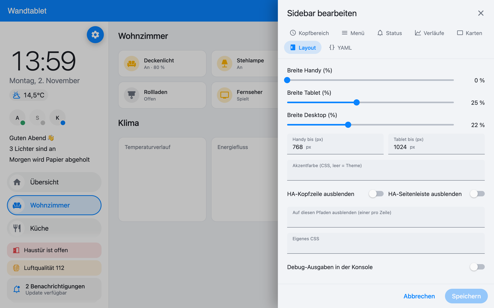

# Sidebar Card 2

Eine globale Sidebar für Home-Assistant-Dashboards – modern, theme-fähig und **direkt im Dashboard per visuellem Editor konfigurierbar**.

Neufassung von [DBuit/sidebar-card](https://github.com/DBuit/sidebar-card) (Lit 3, ohne moment.js/card-tools, ~100 KB statt ~320 KB). Bestehende `sidebar:`-Konfigurationen funktionieren unverändert weiter. Ideen übernommen aus den Forks von [knstyl](https://github.com/knstyl/sidebar-card) (Benachrichtigungen, Personen, Statusleiste, Verläufe) und [Phantom3912/Bobsilvio](https://github.com/Phantom3912/sidebar-card) (Menü-Stile, Farben pro Eintrag).

Getestet gegen Home Assistant 2026.10 (Frontend 20260930).



<sub>Alle Screenshots zeigen Demo-Daten.</sub>

## Screenshots

### Hell und dunkel

Die Sidebar übernimmt Farben und Schrift aus dem aktiven HA-Theme.



### Menü-Stile (`menuStyle`)

| `list` | `wide` | `buttons` (mit Analoguhr) | `grid` |
| :---: | :---: | :---: | :---: |
|  |  |  |  |

### Benachrichtigungen und Verläufe

| Benachrichtigungen (`notifications`) | Verläufe (`trends`) |
| :---: | :---: |
|  |  |

Hinweiszeilen wie „Haustür ist offen“ (`glanceBar` mit `position: attention`) und der Benachrichtigungs-Stapel bleiben unten in der Sidebar sichtbar, auch wenn der Inhalt darüber scrollt.

### Visueller Editor





## Installation

### HACS

1. **HACS → ⋮ → Benutzerdefinierte Repositories**: `https://github.com/marvin-rse/sidebar-card`, Typ **Dashboard**.
2. „Sidebar Card 2“ suchen und herunterladen.
3. Prüfen, dass unter **Einstellungen → Dashboards → ⋮ → Ressourcen** genau ein Eintrag für `sidebar-card.js` steht (HACS legt ihn meist selbst an).
4. Browser bzw. Tablet-App neu laden.

Wer bisher DBuit/sidebar-card über HACS genutzt hat, entfernt diese vorher – beide Repositories heißen `sidebar-card`.

### Manuell

`sidebar-card.js` aus dem [neuesten Release](https://github.com/marvin-rse/sidebar-card/releases/latest) nach `/config/www/sidebar-card/` kopieren und als Ressource `/local/sidebar-card/sidebar-card.js` (Typ: JavaScript-Modul) eintragen.

Sind alte und neue Version gleichzeitig geladen, baut nur eine davon eine Sidebar; in der Browser-Konsole erscheint dann ein Hinweis.

## Bearbeiten

Dashboard öffnen → **Bearbeiten** (oder `?edit=1` an die URL hängen). In der Sidebar erscheint oben rechts ein **Zahnrad**. Es öffnet den Editor mit Live-Vorschau:

| Reiter | Inhalt |
| --- | --- |
| Kopfbereich | Titel, Uhr (digital/analog), Datum, Wetter, Personen, Hinweis-Template |
| Menü | Menü-Stil, Einträge mit Symbol, Aktion beim Tippen/Halten, Aktiv-Entität, Bedingung, Farben; „Ansichten übernehmen“ |
| Status | HA-Benachrichtigungen, Statusleiste bzw. Hinweiszeilen |
| Verläufe | Wischbare Diagramme, Zeiträume, Auto-Weiterblättern |
| Karten | Beliebige Lovelace-Karten unten in der Sidebar (YAML) |
| Layout | Breiten je Gerät, Breakpoints, Akzentfarbe, HA-Kopfzeile/-Seitenleiste ausblenden, eigenes CSS |
| YAML | Die komplette Konfiguration |

Gespeichert wird in die Dashboard-Konfiguration (Schlüssel `sidebar:`), genau wie bisher.

## Konfiguration (YAML)

```yaml
sidebar:
  digitalClock: true
  date: true
  dateFormat: "dddd, D. MMMM"     # optional, Moment-Tokens; leer = automatisch
  weatherEntity: weather.home
  presence: [person.alex, person.sam]
  template: |
    <li>Guten MorgenHallo</li>
  menuStyle: wide                  # list | wide | buttons | grid
  showLabel: true
  sidebarMenu:
    - name: Home
      icon: mdi:home
      tap_action: { action: navigate, navigation_path: /wandtablet/home }
    - name: Licht
      icon: mdi:sofa
      state: light.wohnzimmer      # hervorgehoben, solange an
      tap_action: { action: toggle, entity: light.wohnzimmer }
      hold_action: { action: more-info, entity: light.wohnzimmer }
      conditional: "{{ is_state('input_boolean.gaeste', 'off') }}"
      background_color: "rgba(255, 200, 140, .9)"
  notifications: true
  glanceBar:
    position: attention            # oder Liste ohne position = Symbole unten
    items:
      - entity: binary_sensor.haustuer
        icon: mdi:door-open
        label: "{name} offen"
      - entity: sensor.co2
        label: "CO₂ {state} {unit}"
        tone: { warn_above: 1000, alert_above: 1500 }
  trends:
    ranges: [24h, 7d]
    autoAdvance: 10
    items:
      - name: Temperatur
        entities: [sensor.aussen, sensor.wohnzimmer]
      - entity: sensor.aqi
        bands: aqi
  cards:
    - type: custom:mushroom-media-player-card
      entity: media_player.wohnzimmer
  cardStyle: ":host { width: 100%; }"
  width: { mobile: 0, tablet: 25, desktop: 20 }
  breakpoints: { mobile: 768, tablet: 1024 }
  accentColor: "#ff9800"
  hideTopMenu: false
  hideHassSidebar: false
  hideOnPath: [/wandtablet/kameras]
  style: |
    :host { --sidebar-background: #10131a; }
```

Aktionen sind die Standard-Aktionen von Home Assistant (`navigate`, `more-info`, `toggle`, `perform-action`, `url`, `assist`, `none`, inklusive `confirmation`).

### Kompatibilität mit v1

- Menüeinträge mit `action:`/`navigation_path:`/`service:`/`service_data:` funktionieren weiter. Der Editor stellt sie beim Öffnen auf `tap_action` um.
- `bottomCard: { type, cardOptions, cardStyle }` wird weiter gelesen. Der Editor macht daraus `cards:` und `cardStyle:`.
- `conditional:` wird jetzt von Home Assistant selbst ausgewertet (echtes Jinja statt der bisherigen Muster-Erkennung).
- `service-js` funktioniert weiter, ist aber nur im YAML-Reiter bearbeitbar. `this` ist jetzt das Menü-Element (mit `this.hass`).
- CSS-Variablen `--sidebar-background`, `--sidebar-text-color`, `--sidebar-icon-color`, `--sidebar-selected-text-color`, `--sidebar-selected-icon-color` und die Uhr-Variablen (`--face-color` …) gelten weiter.
- `?sidebarOff` in der URL deaktiviert `hideTopMenu`/`hideHassSidebar`. Im Bearbeitungsmodus bleibt die HA-Kopfzeile immer sichtbar.
- Neues Standard-Datumsformat: „Montag, 2. November“ (vorher `DD MMMM`).

## Entwicklung

```sh
npm install
npm run build      # dist/sidebar-card.js
npm run watch
npm run typecheck
```

## Lizenz

MIT. Ursprüngliche sidebar-card von DBuit und Mitwirkenden.
